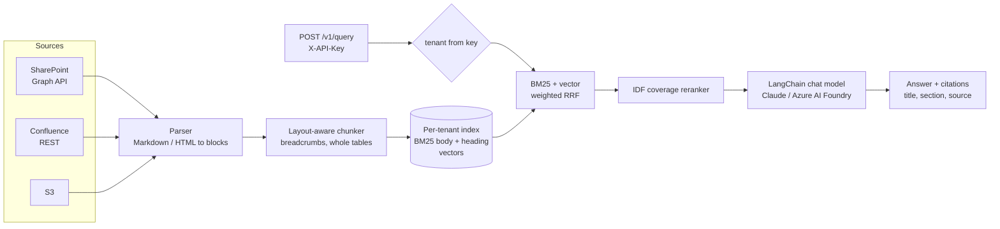

# EnterpriseRAGPlatform

[](https://github.com/Jain-Karan/enterprise-rag-platform/actions/workflows/ci.yml)


A multi-tenant retrieval-augmented generation service built for the part of enterprise RAG that
demos skip: messy document sources, per-customer isolation, and knowing whether retrieval is
actually good before anyone asks the model a question.

- **Sources:** SharePoint (Microsoft Graph), Confluence Cloud, S3, local files. A new source is
  a YAML entry, not a code change.
- **Layout-aware chunking:** Markdown and HTML are parsed into headings, paragraphs, tables,
  lists and code. Tables are never split mid-row, and every chunk carries its
  `Title > Section` breadcrumb.
- **Hybrid retrieval:** two-field BM25 (body + breadcrumb) and vector search, fused with
  weighted Reciprocal Rank Fusion, then a candidate-set IDF reranker.
- **Tenant isolation:** one index per tenant, with the tenant resolved from the API key and
  never from the request body. Chunks are re-checked on the way out.
- **Generation through LangChain:** Claude (`langchain-anthropic`), Azure AI Foundry / Azure
  OpenAI deployments (`langchain-openai`), or an offline extractive model for CI. Keys are
  bring-your-own.
- **Benchmark on day one:** `ragp onboard` ingests a tenant and runs its golden set, and CI
  fails if the default config drops below its measured floor.



## Quickstart

```bash
pip install -e ".[dev]"
python benchmarks/generate_corpus.py                       # seeded synthetic corpus
ragp onboard -c config/bench.yaml -t acme-insurance        # ingest + golden-set benchmark
ragp query   -c config/bench.yaml -t acme-insurance "What is the daily lodging limit in Japan?"
```

Serve the API:

```bash
export ACME_API_KEY=dev-acme
ragp serve -c config/bench.yaml
curl -s localhost:8000/v1/query -H "X-API-Key: dev-acme" -H "content-type: application/json" \
     -d '{"question": "Settlement authority limit for a senior adjuster on Cyber claims?"}'
```

To use a real model, set `llm.provider: anthropic` with `ANTHROPIC_API_KEY`, or
`llm.provider: azure_foundry` with `AZURE_OPENAI_ENDPOINT` and `AZURE_OPENAI_API_KEY`.

## Onboarding a tenant

Adding a tenant, or a source to a tenant, is a config change. Secrets are `${ENV}` references,
never literals. See [`config/tenants.example.yaml`](config/tenants.example.yaml).

```yaml
- tenant_id: acme-insurance
  api_keys: ["${ACME_API_KEY}"]
  benchmark: golden/acme.jsonl          # run automatically by `ragp onboard`
  sources:
    - name: confluence-wiki
      type: confluence
      params: { base_url: https://acme.atlassian.net, space_key: CLAIMS,
                email: "${ACME_CONFLUENCE_EMAIL}", api_token: "${ACME_CONFLUENCE_TOKEN}" }
    - name: s3-exports
      type: s3
      params: { bucket: acme-kb-exports, prefix: policies/ }
```

`ragp onboard` on the benchmark tenants: acme (34 docs, 285 chunks) ingests and benchmarks in
**1.1 s**, and northwind (17 docs, 128 chunks) in **0.3 s**, measured on a 2-vCPU cloud container.

## Benchmark

`benchmarks/generate_corpus.py` builds two synthetic tenants: an insurer (claims, underwriting,
travel policies: 34 documents across lines of business and countries) and a bank (payments runbooks, credit
policy). Real policy libraries are hard to retrieve over because dozens of documents share the
same structure. Every line of business has a "Settlement Authority" table with the same row
labels, so `| Senior Adjuster | $742,300 |` means nothing without its document and section.
The generator reproduces that, and every answer value is unique across the corpus.

| metric | meaning |
|---|---|
| answer recall@5 | a top-5 chunk contains the exact answer string |
| **attributable@5** | that chunk also names its document, so the model can tell *which* policy it came from |
| doc recall@5 | a top-5 chunk comes from the right document |
| MRR | reciprocal rank of the first answer-bearing chunk |

Results from `python benchmarks/run_benchmark.py` (offline hashing embedder, `top_k=5`):

| tenant | config | chunks | answer recall@5 | attributable@5 | doc recall | MRR |
|---|---|---|---|---|---|---|
| acme-insurance | fixed window + BM25 | 117 | 100.0% | 49.4% | 100.0% | 0.893 |
| acme-insurance | fixed window + vector | 117 | 67.4% | 40.6% | 79.7% | 0.522 |
| acme-insurance | fixed window + hybrid + rerank | 117 | 90.3% | 49.4% | 100.0% | 0.829 |
| acme-insurance | layout-aware + BM25 | 285 | 100.0% | 100.0% | 100.0% | 0.778 |
| acme-insurance | layout-aware + vector | 285 | 54.2% | 54.2% | 91.6% | 0.352 |
| acme-insurance | layout-aware + hybrid | 285 | 88.7% | 88.7% | 99.7% | 0.677 |
| acme-insurance | **layout-aware + hybrid + rerank (default)** | 285 | **98.7%** | **98.7%** | 100.0% | **0.946** |
| northwind-bank | fixed window + BM25 | 47 | 100.0% | 81.8% | 100.0% | 0.972 |
| northwind-bank | fixed window + vector | 47 | 94.8% | 79.2% | 97.4% | 0.707 |
| northwind-bank | fixed window + hybrid + rerank | 47 | 98.7% | 81.8% | 100.0% | 0.965 |
| northwind-bank | layout-aware + BM25 | 128 | 100.0% | 100.0% | 100.0% | 0.855 |
| northwind-bank | layout-aware + vector | 128 | 74.0% | 74.0% | 96.1% | 0.465 |
| northwind-bank | layout-aware + hybrid | 128 | 100.0% | 100.0% | 100.0% | 0.792 |
| northwind-bank | **layout-aware + hybrid + rerank (default)** | 128 | **100.0%** | **100.0%** | 100.0% | **1.000** |

What the numbers say, including the unflattering parts:

- **Chunking decides attributability.** Fixed 220-token windows find the answer string, but on
  acme half of those hits (49.4% attributable) are table fragments with no title. Layout-aware
  chunks keep the document's identity with the answer (98.7% to 100%).
- **The offline embedder is weak.** Vector-only retrieval trails BM25 by a wide margin on this
  jargon-heavy corpus, which is why the default `vector_weight` is 0.3. With a semantic
  embedding model (any LangChain `Embeddings` via `LangChainEmbedder`), raise it and re-run the
  benchmark. That comparison isn't included here because this repo's CI runs offline.
- **BM25 alone already reaches 100% recall@5**. The reranker's job is ranking: it lifts MRR
  from 0.778 to 0.946 on acme and from 0.855 to 1.000 on northwind, which matters when the model
  reads the top passages first.
- **The corpus is synthetic** and the golden questions are templated, so absolute numbers are
  higher than on real documents. The *relative* comparisons are the point.

## How retrieval got here

The first version (v0.1.0 defaults) scored **88.4%** recall@5 / **0.866** MRR on acme. Five
issues found by reading benchmark misses took it to **98.7% / 0.946**:

| # | problem found | fix | effect on the benchmark |
|---|---|---|---|
| 1 | Breadcrumbs read `Title > Title > Section` because the H1 repeated the title | skip an H1 that matches the title | correct, but recall *fell* (northwind 90.9% → 89.6%) and exposed #2 |
| 2 | Short boilerplate chunks (Training, Definitions) outranked the long section holding the answer | score breadcrumbs as a separate BM25 field | layout + BM25 recall: 100% on both tenants |
| 3 | Benchmark gave full credit to answers in headerless table fragments | add attributable recall | fixed windows: 49.4% attributable on acme |
| 4 | Default hybrid scored below BM25 alone | weighted RRF, `vector_weight` 0.3 for the offline embedder | acme 91.0% → 94.2% |
| 5 | Reranker weighted "single payment limit" over the rail name in "FedNow: single payment limit?" | IDF weighting over the candidate set | acme MRR 0.910 → 0.946; northwind 0.907 → 1.000 |

Each fix landed as its own pull request with a regression test that fails before the change.
CI now gates on the benchmark (`tests/test_benchmark_gate.py`).

## Layout

```
src/ragplatform/
  connectors/      sharepoint.py  confluence.py  s3.py  local.py
  parsing.py       Markdown / HTML -> layout blocks
  chunking.py      LayoutAwareChunker, FixedWindowChunker
  index/           bm25.py  vector.py  hybrid.py (weighted RRF)
  rerank.py        CoverageReranker (candidate-set IDF), CrossEncoderReranker (optional)
  store.py         per-tenant index, persistence, isolation checks
  generation.py    LangChain chat models, prompt, citation parsing
  platform.py      ingest / retrieve / answer orchestration
  api.py           FastAPI service
  cli.py           ragp onboard | ingest | query | serve
benchmarks/        corpus generator, benchmark runner
tests/             unit, connector (moto, httpx mock transport), API, benchmark gate
```

## Development

```bash
pip install -e ".[dev]"
ruff check . && ruff format --check .
pytest --cov=ragplatform
```

Pushes to `main` are mirrored to GitLab by `.github/workflows/mirror-gitlab.yml`.

## License

MIT
